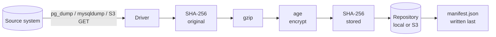

# Cistern

**One tool, one snapshot format and one set of alerts for backing up databases, brokers and object storage — with restores you can verify.**

[](LICENSE)
[](go.mod)
[](#project-status)

Cistern is a single static Go binary that dumps your data with each system's own tools, streams it
through compression and client-side encryption into a repository (local disk or S3 with Object Lock),
and records every snapshot in a plain manifest. The same binary verifies checksums, restores into a
fresh target, applies retention, exports Prometheus metrics and posts webhooks when something breaks.

Backups are only worth what their restores are worth, so Cistern is built around three rules:

- **Recoverable without Cistern.** Every artifact is a standard [age](https://age-encryption.org)
  file wrapping gzip wrapping the native dump. If Cistern is gone, `age -d | gunzip | pg_restore` still works.
- **Integrity is checked, not assumed.** Each artifact carries SHA-256 checksums of the original and
  the stored bytes; a snapshot only exists once its manifest is written.
- **Backups survive the compromise of the machine that makes them.** The backup host holds only a
  public key, and the S3 repository can lock every object (COMPLIANCE or GOVERNANCE mode).

## Features

- **Drivers** for PostgreSQL, MySQL/MariaDB and S3-compatible object storage (incremental by ETag)
- **Repositories** on local disk or S3-compatible storage (AWS S3, MinIO) with Object Lock
- **Client-side encryption** with age (X25519), interoperable with the `age` CLI
- **Streaming pipeline**: dump → SHA-256 → gzip → age → SHA-256 → upload, memory bounded to one upload part
- **Verify and restore**: full verification with the private key, stored-checksum verification without it
- **GFS retention** (`last`, `hourly`, `daily`, `weekly`, `monthly`, `yearly`) that never drops a snapshot another one depends on
- **Scheduler daemon** with cron expressions, plus one-shot mode for Kubernetes CronJobs and systemd timers
- **Observability**: Prometheus metrics (scrape, Pushgateway or node_exporter textfile), ready-made alert rules, Slack/Teams/Telegram/JSON webhooks
- **No dependencies beyond the Go standard library** (a vendored subset of `golang.org/x/crypto` for ChaCha20-Poly1305)

## Supported systems

| System | Driver | Status | Docs |
| --- | --- | --- | --- |
| PostgreSQL | `postgres` | Stable — tested with PostgreSQL 16 | [docs/drivers/postgres.md](docs/drivers/postgres.md) |
| MySQL, MariaDB | `mysql` | Stable — tested with MySQL 8.4 and MariaDB 11.4 | [docs/drivers/mysql.md](docs/drivers/mysql.md) |
| S3-compatible object storage | `s3` | Stable — tested with MinIO | [docs/drivers/s3.md](docs/drivers/s3.md) |
| MongoDB, Redis, etcd, Elasticsearch, Kafka, RabbitMQ, NATS, `exec` | — | Planned (driver names are registered but return "not implemented") | [Roadmap](#project-status) |

| Repository | Status |
| --- | --- |
| Local filesystem | Stable |
| S3-compatible (AWS S3, MinIO), optional Object Lock | Stable — tested with MinIO |

## Quick start

Build from a checkout of this repository (Go 1.24 or newer):

```sh
make build                      # produces bin/cistern
```

Create an encryption key. Keep `identity.txt` **outside** the backup system; Cistern only needs the
public key to make backups.

```sh
./bin/cistern keygen --out identity.txt > recipient.txt
```

Write a configuration, here a local repository and one PostgreSQL job:

```yaml
# cistern.yaml
repositories:
  local:
    type: local
    path: /var/lib/cistern/repo

encryption:
  recipients_file: recipient.txt
  identity_file: identity.txt      # only needed to verify fully and to restore

jobs:
  - name: orders-db
    driver: postgres
    schedule: "0 2 * * *"            # used by `cistern daemon`
    retention: { last: 3, daily: 7, weekly: 4 }
    params:
      host: db.internal
      user: backup
      password: ${PGPASSWORD}
      databases: [orders]
```

Then back up, inspect, verify and restore into a new database:

```sh
export CISTERN_CONFIG=cistern.yaml PGPASSWORD=...
cistern check   --job orders-db                 # tools present, source reachable, repository writable
cistern backup  --job orders-db
cistern list    --job orders-db
cistern verify  --job orders-db                 # decrypts and checks both checksums
cistern restore --job orders-db --set restore_suffix=_restored --yes
cistern prune   --job orders-db --dry-run       # show what retention would remove
cistern daemon                                  # run jobs on schedule, serve /metrics
```

See [Getting started](docs/getting-started.md) for the full walkthrough.

## How it works



A snapshot is a directory in the repository:

```
<prefix>/<job>/<snapshot-id>/manifest.json
<prefix>/<job>/<snapshot-id>/artifacts/<artifact>.gz.age
<prefix>/locks/<job>.lock
```

The manifest records the source version and host, every artifact with its sizes and checksums, the
recipients used and the snapshots it depends on. See [Architecture](docs/architecture.md).

## Documentation

| Guide | |
| --- | --- |
| [Getting started](docs/getting-started.md) | Build, first backup, restore, schedule |
| [Configuration reference](docs/configuration.md) | Every key, default and validation rule |
| [CLI reference](docs/cli.md) | Commands, flags, exit codes, environment variables |
| [Drivers](docs/drivers/) | PostgreSQL, MySQL/MariaDB, S3 |
| [Repositories](docs/repositories.md) | Local and S3, Object Lock, IAM, lifecycle rules |
| [Encryption and keys](docs/encryption.md) | age keys, key management, threat model |
| [Observability](docs/observability.md) | Metrics, alerts, webhooks, `/status` |
| [Deployment](docs/deployment.md) | Daemon vs one-shot, Docker, Kubernetes, systemd |
| [Disaster recovery](docs/disaster-recovery.md) | Restoring without Cistern |
| [Architecture](docs/architecture.md) | Snapshot format, retention, incremental backups, writing a driver |

The original product requirements and technical design (in Vietnamese) are kept in
[docs/design](docs/design/).

## Project status

Cistern is **pre-1.0**. Everything listed as stable above runs end to end against real systems in
the test suite, but the snapshot format and configuration may still change before 1.0.

Known gaps:

- `hooks` (pre/post backup and restore) are parsed but **not executed yet**
- The container image and Kubernetes manifests in [deploy/](deploy/) have not been verified
- No IRSA / instance-profile credentials for S3 yet; use static keys or `AWS_*` variables
- The remaining drivers listed under *Planned*

See [CHANGELOG.md](CHANGELOG.md) for what changed in each release.

## Contributing

Contributions are welcome. Read [CONTRIBUTING.md](CONTRIBUTING.md) for the development setup, the
test suite (including end-to-end tests against real databases in Docker) and the checklist for new
drivers. Please follow the [Code of Conduct](CODE_OF_CONDUCT.md).

## Security

Please report vulnerabilities privately as described in [SECURITY.md](SECURITY.md).

## License

Cistern is licensed under the [Apache License 2.0](LICENSE). It includes a subset of
`golang.org/x/crypto` under the BSD 3-Clause license; see [NOTICE](NOTICE).
