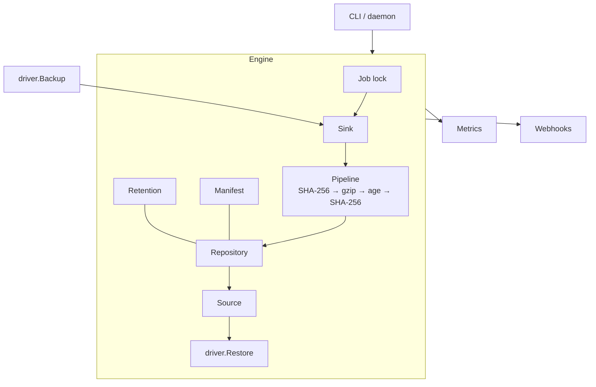

# Architecture

Cistern is one Go binary. A generic engine handles scheduling, locking, the data pipeline, the
snapshot format, verification, retention, metrics and webhooks; each kind of system is a driver that
only knows how to read data out and write it back.



## Backup flow

1. Take the job lock (`<prefix>/locks/<job>.lock`, created with `If-None-Match: *` on S3 or `link(2)`
   locally). An expired lock (start + timeout + 10 minutes) is removed.
2. Call `Driver.Backup` with a sink. Every `sink.Create(name)` starts an upload goroutine fed by an
   `io.Pipe`, so dumping, compressing, encrypting and uploading run concurrently and memory stays
   bounded.
3. When the driver returns, check that every artifact was closed and at least one was written.
4. Write `manifest.json`. Its presence is what makes the snapshot complete.
5. Optionally prune, then update metrics and send webhooks.

If any step fails, artifacts already uploaded are deleted, no manifest is written, and the failure is
reported through metrics and webhooks.

## Snapshot format

```
<prefix>/<job>/<snapshot-id>/manifest.json
<prefix>/<job>/<snapshot-id>/artifacts/<artifact-name>[.gz][.age]
<prefix>/locks/<job>.lock
```

- **Snapshot ID**: `YYYYMMDDTHHMMSSZ-xxxx` (UTC start time and 4 random hex digits).
- **Job name**: `[a-z0-9][a-z0-9._-]{0,62}`, not `locks`.
- **Artifact name**: `/`-separated segments of `[A-Za-z0-9._@=+-]`, no `.` or `..` segments.

### Manifest (`format: 1`)

| Field | Type | Meaning |
| --- | --- | --- |
| `format` | int | `1` |
| `id`, `job`, `driver` | string | Snapshot, job and driver |
| `status` | string | Always `completed` (incomplete snapshots have no manifest) |
| `started_at`, `finished_at` | RFC 3339 | Retention uses `finished_at` |
| `source.version`, `source.host`, `source.extra` | string, string, map | Source version, host without credentials, driver details |
| `compression`, `encryption` | string | `gzip` / `none`; `age-x25519` / `none` |
| `recipients` | list | Public keys the artifacts are encrypted to |
| `depends_on` | list | Snapshots needed to restore this one |
| `artifacts[]` | list | `name`, `path`, `plain_size`, `stored_size`, `plain_sha256`, `stored_sha256` |
| `cistern_version`, `hostname` | string | Version and host that made the snapshot |

### Lock file

JSON `{host, pid, op, snapshot, started, expires}`. `cistern backup` and `cistern prune` take the
lock; restore and verify do not.

## Pipeline

```
driver ──► SHA-256 (original) ──► gzip ──► age ──► SHA-256 (stored) ──► repository
```

Reading reverses the chain and compares both checksums and both sizes when the stream ends. Readers
that stop early still drain and check the rest on `Close`, so a driver cannot accidentally skip
verification. age payloads are authenticated per 64 KiB chunk, and the final chunk is flagged, so
truncation is detected.

## Retention

GFS on `finished_at` in `scheduler.timezone`. Snapshots are sorted newest first; each rule walks the
list and keeps the first snapshot of each new period (hour, day, ISO week, month, year) until it has
kept its count; `last` keeps the N newest. A snapshot is kept if any rule keeps it, and every
snapshot in the `depends_on` of a kept snapshot is kept too.

Prune deletes the manifest first and then the artifacts, so an interrupted prune leaves an
incomplete snapshot that the next prune cleans up. Directories without a manifest are removed once
they are older than one hour (younger ones may belong to a running backup).

## Incremental backups

`Sink.Previous()` gives a driver the newest completed snapshot of the job (if the private key is
available to read it). The S3 driver uses it to reuse unchanged objects, recording the snapshot that
holds each object's data and listing those snapshots in `Info.DependsOn`. On restore, the driver opens
those snapshots through `driver.Resolver`, which only allows snapshots in `depends_on`. See
[S3 driver](drivers/s3.md#how-incremental-backups-work).

## Writing a driver

```go
type Driver interface {
	Name() string
	Check(ctx context.Context) error                     // tools present, source reachable
	Backup(ctx context.Context, sink Sink) (Info, error) // write one or more artifacts
	Restore(ctx context.Context, src Source) error
}

type Sink interface {
	Create(name string) (io.WriteCloser, error) // the engine compresses, encrypts, hashes and uploads
	Previous() Source                           // newest snapshot, for incremental drivers; may be nil
}

type Source interface {
	List() []string
	Open(name string) (io.ReadCloser, error) // checksum errors surface at EOF or on Close
}

type Info struct {
	Version, Host string
	Extra         map[string]string
	DependsOn     []string
}

// Optional: data that lives outside the repository (for example Elasticsearch snapshots).
type Forgetter interface {
	Forget(ctx context.Context, info Info) error
}

func Register(name string, f Factory) // call from init()
```

Helpers in `internal/driver`:

- `Run` / `Output` run external commands with the job's context, kill the whole process group on
  timeout (SIGTERM, then SIGKILL after 30 s) and attach the last 4 KiB of stderr to errors. A failing
  writer (for example a broken upload) cancels the command.
- `PrivateDir` / `WriteSecretFile` create 0700 directories and 0600 files under `CISTERN_TMPDIR` for
  credentials.
- `Abort` closes a source reader on an error path without downloading the rest for verification.

The testing and documentation checklist is in [CONTRIBUTING.md](../CONTRIBUTING.md#adding-a-driver).

## Design decisions

| Decision | Why |
| --- | --- |
| age format for encryption | Restorable with the standard `age` CLI; backup hosts only need public keys |
| gzip | In the standard library; manifests record `compression` so zstd can be added later |
| Manifest written last, no separate catalogue | Object storage needs no extra state; a manifest means a complete snapshot |
| Locks as objects in the repository | Work across hosts and pods without another coordination service |
| Own S3 client (SigV4) | No SDK dependency; only put, get, list, delete and multipart are needed |
| Drivers call native tools via `exec` | Use each system's supported dump format instead of reimplementing it |
| One artifact per object in the S3 driver | Restoring one object is fast; the cost is more objects in the repository |
